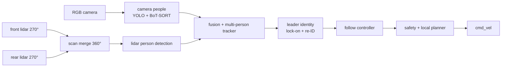

# Leader following in crowds — Ridgeback

**Goal:** a Clearpath Ridgeback follows one chosen person (the *leader*) through
a crowded environment. It keeps the right person when others cross, occlude or
look alike, keeps a safe distance from bystanders, and stops safely when it
cannot confirm the leader. See [docs/GOAL.md](docs/GOAL.md).

The system is built as a **modular baseline** first: lidar keeps track of
people, the camera confirms who the leader is, and a classic planner moves the
base. Learned methods such as the OmTrackVLA vision-language-action model plug
into a stage and are compared against that baseline.



| Stage | Package | Status |
|---|---|---|
| Camera people (YOLO + BoT-SORT) | [`leader_follow/perception`](leader_follow/perception) | implemented, appearance embedding pluggable |
| Scan merge (front + rear → 360°) | DyNAMO-Ridgeback | exists, reuse it |
| Lidar people | [`leader_follow/perception`](leader_follow/perception) | planned |
| Fusion + tracker | [`leader_follow/tracking`](leader_follow/tracking) | planned |
| Leader identity (lock-on state machine) | [`leader_follow/identity`](leader_follow/identity) | implemented; OSNet re-ID and "nearest person in front" lock-on planned |
| Follow controller | [`leader_follow/control`](leader_follow/control) | planned |
| Safety | [`leader_follow/safety`](leader_follow/safety) | planned |
| Evaluation protocol | [docs/EVALUATION.md](docs/EVALUATION.md) | defined, not run |

Nothing in this repository publishes `cmd_vel` yet: the robot does not move.

## Documents

- [GOAL.md](docs/GOAL.md): task, scope, decisions so far, open questions
- [ARCHITECTURE.md](docs/ARCHITECTURE.md): stages, data contracts, sensors, where methods plug in
- [ROADMAP.md](docs/ROADMAP.md): phases with their done conditions
- [EVALUATION.md](docs/EVALUATION.md): scenarios, metrics, ground truth

## Repository map

| Path | Contents |
|---|---|
| `leader_follow/` | The system: one subpackage per stage; [`interfaces.py`](leader_follow/interfaces.py) holds the data passed between stages |
| `robot/` | Shared Ridgeback infrastructure: ROS topics, camera QoS, process ownership, hashing, latency statistics, RViz configs |
| `methods/omtrack_vla/` | OmTrackVLA, one candidate method: model, training, Habitat simulation, Ridgeback model service and benchmarks ([README](methods/omtrack_vla/README.md)) |
| `tests/` | System and infrastructure tests (no models, ROS or GPU) |
| `requirements/`, `setup.sh` | Shared Python environment (`.venv`) |
| `models/` | Downloaded weights (not in Git) |
| `outputs/` | Local run outputs (not in Git) |

## Setup and tests

```bash
bash setup.sh
python3 -m unittest discover -s tests -v
python3 -m unittest discover -s methods/omtrack_vla/tests -t . -v
```

Run Python from the repository root with `PYTHONPATH=.`; every module is
imported from here (`leader_follow.*`, `robot.*`, `methods.omtrack_vla.*`).
`leader_follow` never imports a method; methods import the system's stages.

## Source attribution

See [THIRD_PARTY.md](THIRD_PARTY.md). OmTrackVLA is from
[om-ai-lab/OmTrackVLA](https://github.com/om-ai-lab/OmTrackVLA), upstream revision
`e9cb1fbd57f8dbcf98c460914251cbcbe20f2f57`.
