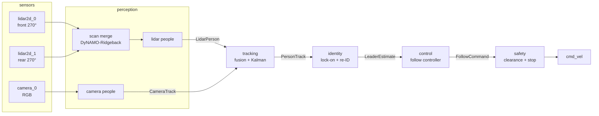
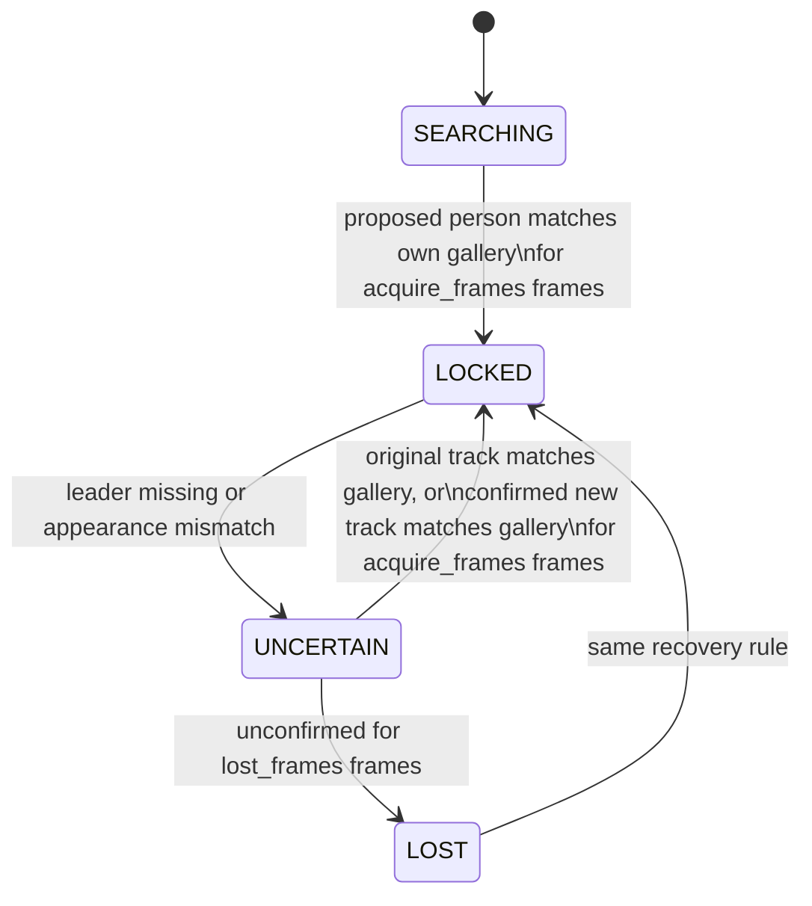

# Architecture

Six stages, each a subpackage of `leader_follow/`. Each stage consumes the
previous stage's type from [`leader_follow/interfaces.py`](../leader_follow/interfaces.py),
so a stage can be replaced without touching the others.

## Stages

| Stage | Input → output | Baseline method | Rate target |
|---|---|---|---|
| **perception** (lidar) | merged 360° `LaserScan` → `LidarPerson[]` in `base_link` | Leg detector or DR-SPAAM. The front + rear scan merge already exists in the DyNAMO-Ridgeback repo; reuse it, do not rebuild it | scan rate |
| **perception** (camera) | image → `CameraTrack[]` | YOLO person boxes, BoT-SORT association, injected appearance embedding | camera rate |
| **tracking** | `LidarPerson[]` + `CameraTrack[]` → `PersonTrack[]` in `odom` | One constant-velocity Kalman filter per person; camera boxes matched to lidar tracks by bearing | scan rate |
| **identity** | `PersonTrack[]` → `LeaderEstimate` | Lock onto the nearest person in front; confirm with a re-ID gallery (OSNet-AIN) plus track continuity; never hand the lock to someone else | scan rate |
| **control** | `LeaderEstimate` → `FollowCommand` | Hold a target distance and bearing; rotate to keep the leader in camera view | ≥ 10 Hz |
| **safety** | `FollowCommand` + scans → `cmd_vel` | Speed caps, minimum clearance to every person, stop-and-search when not `LOCKED` | ≥ 10 Hz |

Only `LOCKED` lets the robot move. `UNCERTAIN` and `LOST` stop the base, and
the robot rotates to search before it locks again.

## Identity state machine

Implemented in [`leader_follow/identity/lock_on.py`](../leader_follow/identity/lock_on.py)
and shared with the OmTrackVLA wrapper.

Who counts as a candidate is decided by two injected callables: `acquire`
(while searching) and `confirm` (during recovery). The OmTrackVLA wrapper
passes prompt grounding for both. The baseline will pass "nearest person in
front of the robot".

## Where methods plug in

| Method | Replaces | Location |
|---|---|---|
| OmTrackVLA (VLA waypoints) | control (and, with prompt grounding, identity acquisition) | [`methods/omtrack_vla/`](../methods/omtrack_vla) |
| Learned crowd-navigation policy | control | not started |
| Learned re-ID (OSNet-AIN) | appearance embedding in perception (camera) | not started |

Dependency rule: `leader_follow` never imports `methods`; a method imports the
stages it reuses. `tests/test_repository.py` enforces this.

## Shared infrastructure (`robot/`)

| Module | Purpose |
|---|---|
| `topics.py` | Ridgeback ROS topic names |
| `ros_camera.py` | Latest-frame QoS, stamp and JPEG helpers |
| `owned_processes.py` | Start and stop only processes this run owns; idle-GPU check |
| `files.py`, `latency.py`, `perf_log.py` | Hashes, fresh output paths, latency percentiles, stage timing |
| `protocol.py` | Length-prefixed JSON socket messages |
| `sample_compute_host.py` | Host CPU, RAM and process-memory telemetry |
| `rviz/` | Live map and lidar view configs |
