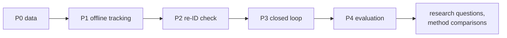

# Roadmap

Each phase ends at a measurable done condition. Research questions and method
comparisons start after P4, once the baseline has numbers.

| Phase | Work | Done when |
|---|---|---|
| **P0 Data** | Record rosbags (both scans, camera, odometry, TF) of the scripted scenarios in [EVALUATION.md](EVALUATION.md). The leader wears a ground-truth tag (AprilTag or UWB) that the system never reads. | About 10 bags with ground-truth leader positions |
| **P1 Offline tracking** | Scan merge, lidar person detection, camera people, fusion tracker; run on the bags | Leader-track coverage and ID switches measured per scenario |
| **P2 Re-ID check** | Pretrained OSNet-AIN embeddings in place of the colour signature; score "pick the leader among nearby people" on bag crops | Accuracy number; fine-tune on bag crops only if it is too low |
| **P3 Closed loop** | Follow controller and safety on the robot; escalate empty room → 1 distractor → 3–5 people → crowd | Each level passes N runs without a safety stop |
| **P4 Evaluation** | Full scenario set with repetitions | Baseline numbers for every metric in [EVALUATION.md](EVALUATION.md) |

## Current state

- Done: the identity state machine and camera people tracker, factored out of
  the OmTrackVLA wrapper and verified to behave identically on scripted tracks.
- Done (method side): OmTrackVLA runs on the Ridgeback as a model service with
  latency benchmarks (`methods/omtrack_vla/docs/BENCHMARKS.md`). It has no
  closed loop and no crowd evaluation.
- Next: P0.
